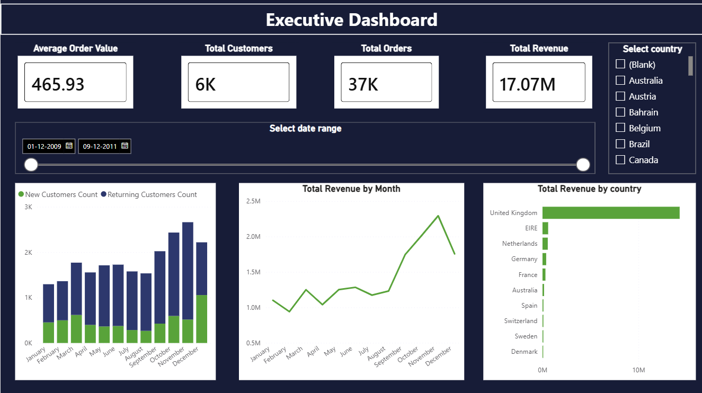
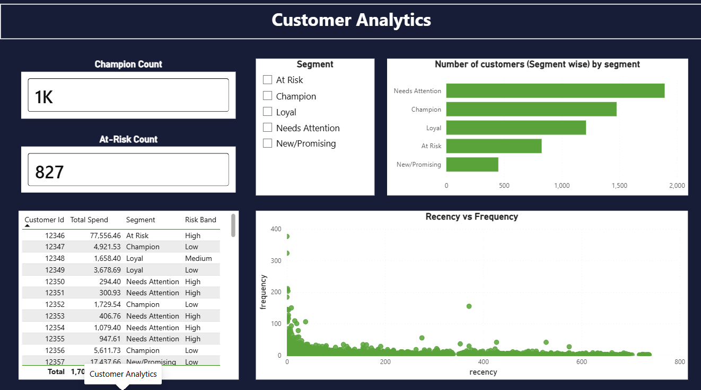
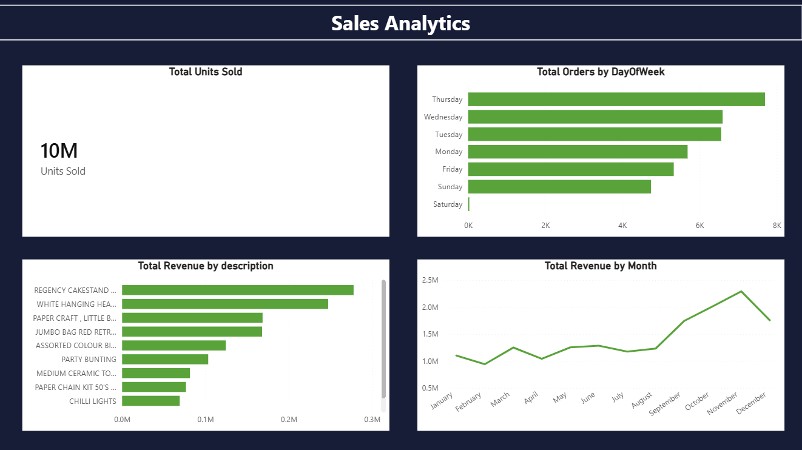
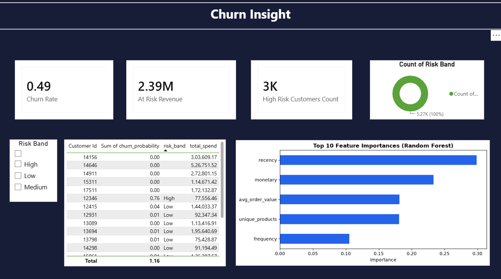

# Retail Customer Intelligence Platform
**Stack:** Python · PostgreSQL · scikit-learn · Power BI · Git
**Dataset:** UCI Online Retail II (~1M transactions, CC BY 4.0)

## What It Does
An end-to-end analytics pipeline that turns two years of raw retail
transactions into customer intelligence: who your best customers are,
how they behave, and who is about to stop buying.

## Architecture

Raw CSV → Python cleaning → PostgreSQL (3 tables) → Python EDA + ML model
→ Power BI dashboard → GitHub

## Results
| Model | ROC-AUC | PR-AUC | Precision in riskiest 20% |
|---|---|---|---|
| **Logistic Regression (final)** | **0.807** | **0.836** | **89.5%** |
| Random Forest | 0.782 | 0.799 | 86.2% |

- Churn = no purchase in the last 90 days of data; base churn rate 56.5%.
- Features use only data before the cutoff, so nothing from the label window leaks in.
- **Logistic Regression is the final model**: it beats Random Forest on every metric with only 5 features, and its coefficients are easy to explain.
- Top churn drivers (LR coefficients): recency raises risk; purchase frequency and product variety lower it.
- 22% of customers drive 80% of revenue (Pareto).
- Limitation: the train/test split is random (stratified), not out-of-time.

## How to Run
```
git clone https://github.com/aditya-anand19/retail-customer-intelligence-platform
cd retail-customer-intelligence-platform
pip install -r requirements.txt
# Download Online Retail II from the UCI ML Repository and save it as
#   data/raw/online_retail_II.csv
# Run notebooks in order: 01 → 02 → 03 → 04
# (04 alone runs on the processed CSVs already in data/processed/)

# Rebuild the Excel intervention model
python scripts/build_excel_model.py

# Optional: AI executive summary (needs a free key from Google AI Studio)
# Windows PowerShell:  $env:GEMINI_API_KEY = "your-key"
# Mac/Linux:           export GEMINI_API_KEY="your-key"
python scripts/generate_executive_summary.py
```
## How AI Was Used
- **Gemini API (Google AI Studio)** drafts the executive summary from the model's outputs. The script validates the result before saving it: it rejects truncated responses and flags any number that does not appear in the source data (output goes to `executive_summary_UNVERIFIED.txt` instead).
- AI coding assistants helped with boilerplate (plotting, Excel formatting). Modelling decisions (churn definition, leakage-safe features, metric and model choice) were made and checked by me.

## Screenshots





## Dataset Citation
Chen, D. (2019). Online Retail II. UCI ML Repository (CC BY 4.0).
